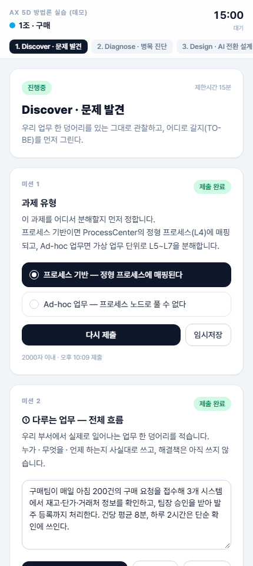
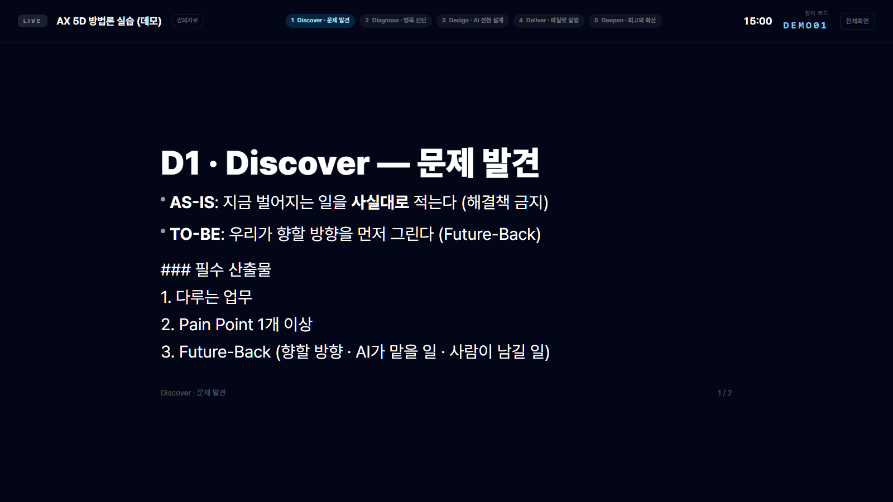
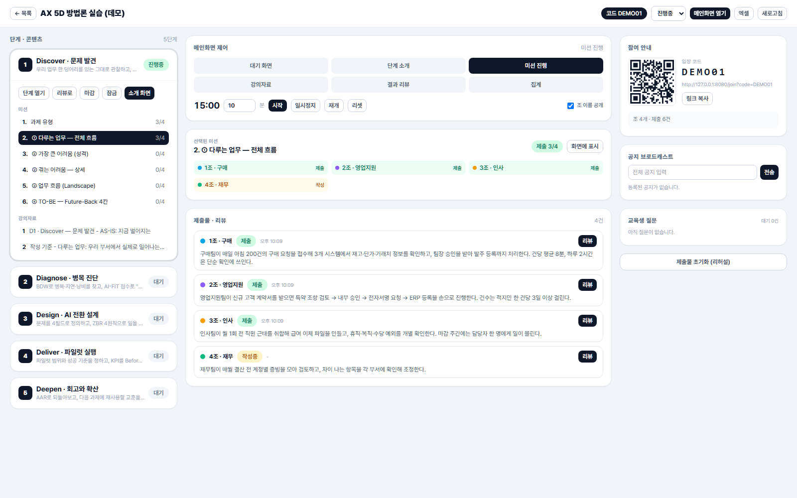

# 실습 진행 서버 (training-server)

**AXCenter 5D 여정(Discover · Diagnose · Design · Deliver · Deepen)** 을 조별 실습으로 운영하는
웹 서버입니다. 교육생은 모바일/노트북으로 접속하고, 강사는 프로젝터 화면과 콘솔을 함께
사용합니다. 모든 상태는 PostgreSQL 에 저장되고 Socket.IO 로 실시간 동기화됩니다.

## 화면 구성

| 경로 | 사용자 | 기기 | 역할 |
| --- | --- | --- | --- |
| `/` → `/join` → `/play` | 교육생(조) | 모바일·노트북 | 입장 코드 입력 → 조 선택 → 미션 답안 작성/제출/첨부, 공지·피드백 확인, 질문 |
| `/screen/:joinCode` | 강사(프로젝터) | 대형 화면 | 대기(QR) · 단계 소개 · 미션 현황 · 강의자료 · 결과 리뷰 · 집계 |
| `/admin` | 강사 | 노트북·태블릿 | 회차/조 생성, 단계 잠금·진행, 미션·슬라이드 송출, 타이머, 피드백, 공지, 질문 응답, 엑셀 |

## 화면 예시

| 교육생 `/play` | 프로젝터 `/screen` | 강사 콘솔 `/admin` |
| --- | --- | --- |
|  |  |  |

## 주요 기능

- 5단계(Stage) 진행 제어: `대기 / 진행중 / 리뷰중 / 마감` 상태 + 강사가 단계를 열면 교육생 화면 즉시 반영
- 미션 유형: 단답, 장문, 선택형, 숫자, URL, **파일·이미지 업로드**(도구 산출물), 임시저장/재제출
- 서버 기준 타이머(초 단위 브로드캐스트, 기기 시계 오차 무시), 일시정지/재개
- 실시간 제출 현황(N/전체 조), 조 이름 익명 공개 토글
- 프로젝터 리뷰 모드: 조별 1건 확대, 이전/다음 이동, 점수·⭐우수·피드백
- 공지 브로드캐스트, 교육생 → 강사 질문 큐와 답변
- 조별 상호 투표(선택), 단계별 진행 집계
- 결과 엑셀(XLSX) 내보내기 (단계/조/답변/피드백)
- QR 로 접속(강사 화면), 리허설용 제출물 초기화

## 빠른 시작 (로컬, Windows/macOS 공통)

```bash
# 1) PostgreSQL (로컬 5432를 쓰지 않도록 5434 사용)
docker run -d --name training-pg \
  -e POSTGRES_USER=training -e POSTGRES_PASSWORD=training -e POSTGRES_DB=training \
  -p 127.0.0.1:5434:5432 postgres:16

# 2) 의존성 + 환경변수
npm install
cp .env.example .env      # Windows PowerShell: Copy-Item .env.example .env

# 3) 스키마 적용 + 데모 데이터
npm run db:migrate
npm run db:seed

# 4-A) 개발 모드 (Vite 5173 + API 8080)
npm run dev
#  → http://localhost:5173

# 4-B) 운영 모드와 동일하게 확인
npm run build && npm start
#  → http://localhost:8080
```

데모 값: 입장 코드 `DEMO01`, 강사 비밀번호는 `.env` 의 `ADMIN_PASSWORD`(기본 `letmein`).

## 강의 진행 순서 (권장)

1. `/admin` 로그인 → **새 교육 만들기** (교육 이름 + 조 이름, AX 5D 기본 콘텐츠 자동 생성)
2. 프로젝터에서 `메인화면 열기` → `전체화면` (QR/입장 코드가 대기 화면에 표시됨)
3. 콘솔에서 `1단계 → 단계 열기` → 미션 클릭 → `화면에 표시`, 타이머 `시작`
4. 제출이 들어오면 `제출물 · 리뷰 → 리뷰` 버튼 → 프로젝터가 해당 조 답안으로 전환, 피드백/점수 저장
5. 필요 시 `강의자료` 목록에서 슬라이드를 클릭해 송출
6. 단계 `마감` → `집계` 화면 → `엑셀` 다운로드, 교육 종료 후 회차 상태를 `종료`로 변경
7. 리허설 후 `제출물 초기화`로 데이터만 비우고 재사용 가능

## 콘텐츠(5D 단계별 미션/강의자료)

기본 콘텐츠는 **AXCenter(5D 과제 관리 포털)** 의 5D 계약을 그대로 옮긴 것입니다.

| 단계 | 필수 산출물 (AXCenter `progress.ts` 기준) |
| --- | --- |
| D1 Discover · 문제 발견 | 다루는 업무 · Pain Point 1개 이상 · Future-Back(향할 방향/AI가 맡을 일/사람이 남길 일/새로 생기는 일) |
| D2 Diagnose · 병목 진단 | BDW 1개 이상 · AI-FIT 1개 이상 · STATIK L7 분해 |
| D3 Design · AI 전환 설계 | 문제 정의 4필드(WHAT·WHY·IMPACT·GOAL) · ZBR 4원칙 · 에이전트 명세 · KPI 1개 이상 |
| D4 Deliver · 파일럿 실행 | 파일럿 범위·성공 기준 · KPI 측정 1건 이상 |
| D5 Deepen · 회고와 확산 | AAR 4질문 + Keep·Stop·Start · 교훈 1개 이상 |

- 원본 근거: `AXCenter/packages/ax-contracts/src/ax.ts`, `apps/ax-center/server/services/progress.ts`,
  `apps/ax-center/client/src/pages/ax/stage-forms/*`
- 콘텐츠 정의: `src/content/ax-5d.ts` (5단계 · 24미션 · 8슬라이드)
- JSON 내보내기: `npm run content:export` → `docs/content.ax-5d.json`
- 회차 단위 교체: `POST /api/admin/sessions/:sessionId/content`

```bash
curl -X POST http://localhost:8080/api/admin/sessions/<SESSION_ID>/content \
  -H "Content-Type: application/json" \
  -H "Cookie: ts_instructor=<로그인 쿠키>" \
  --data-binary @docs/content.ax-5d.json
```

> 교체 시 해당 회차의 단계·미션·제출물이 삭제됩니다. 교육 전에만 사용하세요.

## 프로젝트 구조

```
src/
  index.ts              Express + Socket.IO 부트스트랩
  env.ts                환경변수
  db/                   Drizzle 스키마, 마이그레이션 러너, 시드
  lib/                  인증(JWT 쿠키), 실시간, 타이머, 번들(화면별 응답 조립)
  routes/               auth / public / play / admin(+엑셀)
  content/              AX 5D 기본 콘텐츠(ax-5d.ts) + JSON 내보내기
web/src/
  pages/                Landing, Join, Play, Screen, Admin, AdminConsole
  components/           Countdown, MissionCard, Screen* 패널
drizzle/                생성된 SQL 마이그레이션
docs/content.ax-5d.json
```

## API 요약

강사 API 는 `ts_instructor` JWT 쿠키 필요, 교육생 API 는 `ts_team` 쿠키 필요.

| 메서드 | 경로 | 설명 |
| --- | --- | --- |
| POST | `/api/auth/login` | 강사 로그인(비밀번호) |
| GET | `/api/public/session/:joinCode` | 코드로 교육/조 조회 |
| POST | `/api/public/join` | 조 선택 또는 생성 → 팀 쿠키 |
| GET | `/api/public/screen/:joinCode` | 프로젝터용 번들 |
| GET | `/api/public/qr?data=` | QR PNG |
| GET | `/api/play/state` | 교육생 화면 상태 |
| PUT | `/api/play/submission` | 답안 저장/제출 |
| POST | `/api/play/upload` | 파일 업로드(20MB) |
| POST | `/api/play/question` `/vote` | 질문, 투표 |
| GET | `/api/admin/sessions` | 회차 목록 |
| POST | `/api/admin/sessions` | 회차 + 조 생성 |
| PATCH | `/api/admin/sessions/:id/stages/:stageId` | 단계 상태/시간 변경 |
| PATCH | `/api/admin/sessions/:id/screen` | 모드/미션/슬라이드/익명 토글 |
| POST | `/api/admin/sessions/:id/timer` | start/pause/resume/reset/set |
| POST | `/api/admin/sessions/:id/submissions/:submissionId/feedback` | 피드백/점수 |
| POST | `/api/admin/sessions/:id/announcements` | 공지 |
| POST | `/api/admin/sessions/:id/questions/:questionId/answer` | 질문 답변 |
| GET | `/api/admin/sessions/:id/export.xlsx` | 엑셀 |

실시간 이벤트는 `invalidate`(변경 알림 → 각 화면이 재조회)와 `timer`(1초 주기) 두 가지로
단순하게 유지했습니다. 화면 복원력이 좋고, 데이터 정합성은 항상 DB 를 기준으로 합니다.

## 배포

### Coolify (권장)

GitHub 에 push 하면 Coolify 가 Dockerfile 로 빌드/배포하도록 구성합니다.
자세한 절차·환경변수·문제 해결은 **[`docs/deploy-coolify.md`](docs/deploy-coolify.md)** 를 참고하세요.

요약:

1. Coolify 에서 PostgreSQL 리소스 생성 → internal URL 확보
2. 이 저장소를 Dockerfile 빌드팩으로 등록, Ports `8080`, 도메인 연결
3. 환경변수: `DATABASE_URL`, `ADMIN_PASSWORD`, `JWT_SECRET`, `PUBLIC_BASE_URL`,
   `COOKIE_SECURE=true`, `UPLOAD_DIR=/data/uploads`
4. 영구 볼륨 `/data/uploads` 연결 (첨부파일 보존)
5. Deploy → `https://도메인/api/public/health` 확인 → `/admin` 로그인

### Docker Compose (VPS 권장)

```bash
# .env 에 운영 값 지정 후
docker compose up -d --build
```

- 앱 시작 시 `drizzle/` 의 SQL 마이그레이션이 자동 적용됩니다(`RUN_MIGRATIONS=false` 로 끌 수 있음).
- `ADMIN_PASSWORD`, `JWT_SECRET` 은 반드시 교체하세요.
- HTTPS 뒤에서 운영하면 `COOKIE_SECURE=true`, `PUBLIC_BASE_URL=https://도메인` 을 설정하세요.

### PaaS (Railway / Render / Fly.io 등)

- 빌드: `npm ci && npm run build`, 시작: `node dist/index.js`, 포트는 `PORT` 사용
- 환경변수: `DATABASE_URL`, `ADMIN_PASSWORD`, `JWT_SECRET`, `PUBLIC_BASE_URL`, `COOKIE_SECURE=true`
- 관리형 PostgreSQL 을 연결하면 마이그레이션은 부팅 시 자동 실행됩니다.

### 운영 시 주의

- **단일 인스턴스** 권장: 타이머 브로드캐스트와 업로드가 프로세스 로컬입니다.
  다중 인스턴스가 필요하면 Socket.IO Redis 어댑터 + S3 업로드로 확장하세요.
- 무료 PaaS 는 파일 시스템이 휘발성일 수 있습니다. 첨부파일이 중요하면 볼륨을 붙이세요.
- 교육생 입장은 **입장 코드 + 조 선택** 방식입니다. 외부 노출이 우려되면 조별 PIN 을
  추가하는 것을 권장합니다(스키마에 `pin` 컬럼 추가 후 조인 검증).

## 검증

```bash
npm run typecheck
npm run build

# 서버가 떠 있는 상태에서 전체 흐름을 자동 점검 (회차 생성 → 제출 → 리뷰 → 피드백 → 엑셀)
node scripts/smoke.mjs
```

- 로컬에서 입장 → 제출 → 프로젝터 반영 → 리뷰/피드백 → 엑셀 다운로드까지 확인 완료
- `shots/` 폴더에 주요 화면 스크린샷과 CDP 촬영 스크립트(`shot.mjs`)가 있습니다.
  (`node shots/shot.mjs` 로 재촬영; 실행 중인 서버 필요)
